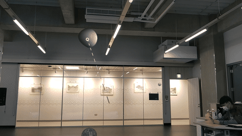
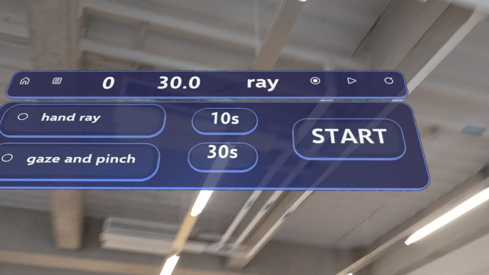
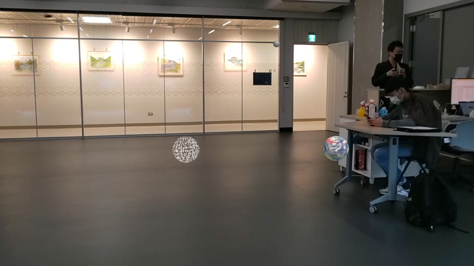
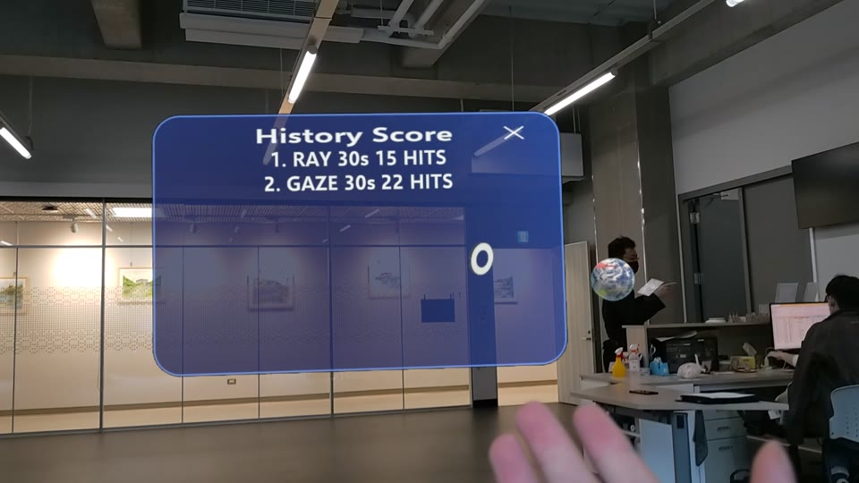

# hololens_aim_bot

An aim trainer for HoloLens 2, built with Unity and MRTK3. Balls spawn around you in the room; you hit as many as you can before the timer runs out, using either hand rays or eye gaze plus a pinch.



Full demo recording (2:14, 1080p, January 2023): [Releases → demo-2023-01](https://github.com/YJack0000/hololens_aim_bot/releases/tag/demo-2023-01)

## How it plays

1. Pick an input mode and a round length (10 s or 30 s) on the floating menu, then press **START**.
2. Three balls spawn near the spawn point. Each hit removes the ball and spawns a new one.
3. When the countdown reaches zero, the round ends and its score goes into **History Score**, ranked by hits per second.

| Start menu | In a round | Score history |
|---|---|---|
|  |  |  |

Input modes:

| Mode | How you hit a ball |
|---|---|
| `HAND_RAY` | Point the hand ray at the ball and pinch. |
| `GAZE_AND_PINCH` | Look at the ball (it grows on hover) and pinch. |
| `BOTH` | Either of the above. Selected by turning on both mode buttons. |

## Project layout

```
Assets/
  0111DEMO/
    Prefabs/              RayBall, GazeBall, RayAndGazeBall
    Scripts/
      GameManager.cs      Game state, countdown, mode toggle, score history
      Balls/              BallManager (spawning) and the ball types
      UI/                 Menu buttons and the history panel
  Scenes/MRTK3_DEMO.unity Main scene
Packages/MixedReality/    MRTK3 pre.13 and Mixed Reality OpenXR 1.7.0 tarballs
```

## Build and run

Requirements:

- Unity **2021.3.16f1** with the Universal Windows Platform build module
- Visual Studio 2022 with the UWP and C++ workloads
- A HoloLens 2, or the Holographic Remoting Player on the device for in-editor testing

Steps:

1. Open the project folder in Unity Hub. The MRTK packages load from `Packages/MixedReality/`, so no Feature Tool step is needed.
2. Open `Assets/Scenes/MRTK3_DEMO.unity`.
3. To test without deploying, start Holographic Remoting Player on the HoloLens, then in Unity open **Mixed Reality → Remoting → Holographic Remoting for Play Mode**, enter the device IP, and press Play.
4. To deploy, switch the platform to **Universal Windows Platform**, build, open the generated `.sln` in Visual Studio, set the target to **Release / ARM64 / Device**, and deploy.

Setup guide (Chinese): https://yjack0000.cerana.tech/articles/post/d1998cfa-a871-463d-a026-77b468ff9fab

## Archive

- [`wip/2023-01-10-local`](https://github.com/YJack0000/hololens_aim_bot/tree/wip/2023-01-10-local): local changes from 2023-01-10 that were never committed. Based on an older commit; kept for reference, not for merging.
- [mrtk3-prototype-2023-01](https://github.com/YJack0000/hololens_aim_bot/releases/tag/mrtk3-prototype-2023-01): source of the earlier MRTK3 + Vuforia practice project.

## Credits

Built by [@williiam](https://github.com/williiam) and [@YJack0000](https://github.com/YJack0000) in January 2023. Upstream: [williiam/hololens_aim_bot](https://github.com/williiam/hololens_aim_bot).
